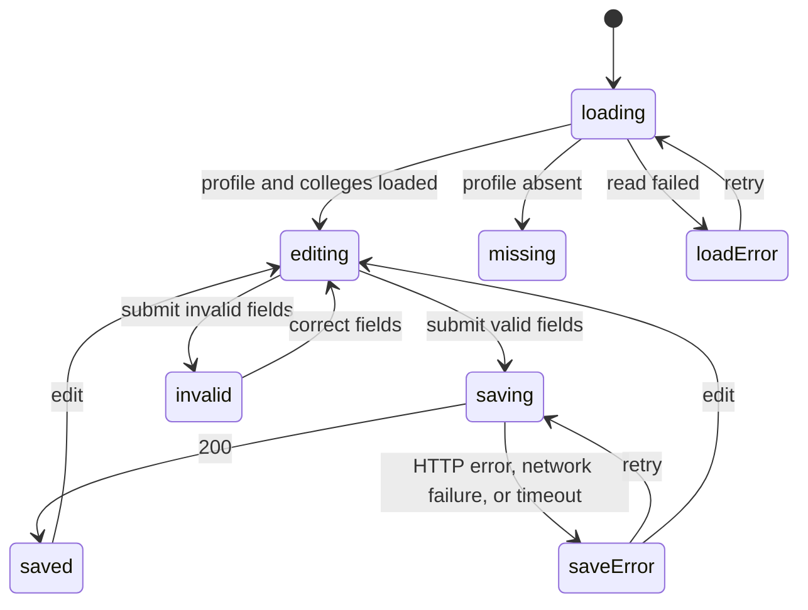

# Students can load and save their own profile information

## Why

Students can return to their profile, edit personal information, and save it
without creating a duplicate profile or losing edits when a request fails.

## Where it lives

- `apps/web/app/profile/page.tsx`: loads the current profile and colleges.
- `apps/web/components/ProfileForm.tsx`: edits and saves profile fields.
- `apps/web/app/api/profiles/me/route.ts`: `PATCH /api/profiles/me`.
- `packages/domain/src/schemas/profiles.ts`: `UpdateProfile` validation.
- `packages/domain/src/queries/profiles.ts`: user-scoped read and update.
- `packages/domain/src/queries/colleges.ts`: shared college choices.
- `packages/domain/tests/profile-schema.test.ts`: validation tests.
- `tests/integration/profiles.test.ts`: persistence and ownership tests.

## Behavior

- `/profile` derives identity using `currentUserId()` and loads only that
  student's profile, alongside the college reference list, on the server.
  It never loads a Student record or password hash for the form.
- Existing values populate the form. Null values display as empty inputs.
  An existing profile with all optional fields empty is editable.
- A missing profile displays a not-found state; editing does not create one.
  Missing identity displays a sign-in-required state. Identity currently
  uses the development stub described in [auth](../auth.md).
- The form uses `description`, `linkedin`, `github`, `profileUrl`, and
  `collegeId` consistently. College option values are database IDs, with
  college names as labels. No selection means no college.
- Standing is absent because the data model has no corresponding field.
- `PATCH /api/profiles/me` derives identity, validates input, and updates
  only the profile whose `studentId` equals the derived identity.
- Requests contain at least one editable field. Unknown fields, including
  `studentId`, are rejected. Omitted fields are unchanged; null or a trimmed
  empty string clears a field. All supplied strings are trimmed.
- Description is at most 2,000 characters; it has no minimum length.
  LinkedIn and GitHub accept HTTP(S) profile URLs on `linkedin.com/in/…`
  (including `www.linkedin.com`) and `github.com/…` (including `www.github.com`)
  respectively. `profileUrl` accepts an HTTP(S) URL without requiring an
  image filename extension. URLs are at most 2,048 characters.
- A nonempty `collegeId` must identify an existing college. Unknown college
  IDs return 404 `NOT_FOUND`. Missing profiles also return 404; the caller
  cannot select another student's profile.
- Successful updates return 200 `{ profile }`. Invalid JSON returns 400
  `BAD_JSON`; invalid fields return 400 `VALIDATION`; missing identity
  returns 401 `UNAUTHENTICATED`. Unexpected failures return a generic 500
  `INTERNAL_ERROR`. All errors use `{ error: { code, message } }`.
- Save disables while pending and ignores additional submissions until the
  request finishes. Fields disable during saving. Success shows "Profile
  saved" and retains the saved values. HTTP and network failures show an
  error and retain edits for retry. A 15-second client timeout also exits
  pending; it cannot guarantee that the server did not commit the update.

## UI states

The read region has a skeleton, a missing-profile message, and an error card
with Retry. The form uses native labels and controls, associates field errors
with inputs, focuses the first invalid field, and announces save feedback.

## Examples

| State / input | Behavior |
|---|---|
| Existing description on page load | Form displays the saved description |
| PATCH `{ "description": "Hello" }` | Saves the current student's description |
| PATCH `{ "github": "" }` | Clears GitHub to null |
| PATCH `{ "studentId": "someone-else" }` | 400 VALIDATION; no write |
| PATCH `{ "collegeId": "unknown-college" }` | 404 NOT_FOUND; no write |
| PATCH a 2,001-character description | 400 VALIDATION |
| Save fails | Error shown; typed fields retained; Save available again |
| Reload after a successful save | Persisted values appear |

## Verify

- Run `pnpm test`, `pnpm test:integration`, `pnpm typecheck`, and `pnpm build`.
  Tests cover accepted and rejected inputs, persistence, clearing fields,
  unknown colleges, missing profiles, and isolation between two students.
- With `pnpm dev` and seeded data, edit the current profile, save, and reload;
  verify the values persist and the profile count does not increase.
- Throttle the network and reload to check the read skeleton. Stop the
  server after loading, then save: edits remain and the form becomes usable.
- Double-click Save and press Enter repeatedly during a delayed save;
  verify only one PATCH is sent. Check a stalled request exits after timeout.
- Use only the keyboard to edit, select a college, submit invalid data,
  correct it, and save. Record actual screen-reader announcements during
  manual verification; no transcript is assumed by this spec.

## Constraints & decisions

- Initial reads happen on the server because identity and initial form
  values are available there. Validation and queries live in the domain
  package, following [monorepo](../monorepo.md).
- Updating optional profile fields uses the existing schema and adds no
  dependencies. No migration is needed.
- The existing public list and empty-profile creation endpoints remain
  described by [profiles](profiles.md); the editing form does not use them.

## Out of scope

- Authentication implementation, signup changes, and existing-profile backfill.
- Class standing, uploads, account email changes, deletion, and public-list changes.
- Optimistic updates: Save waits for persistence before showing success.
